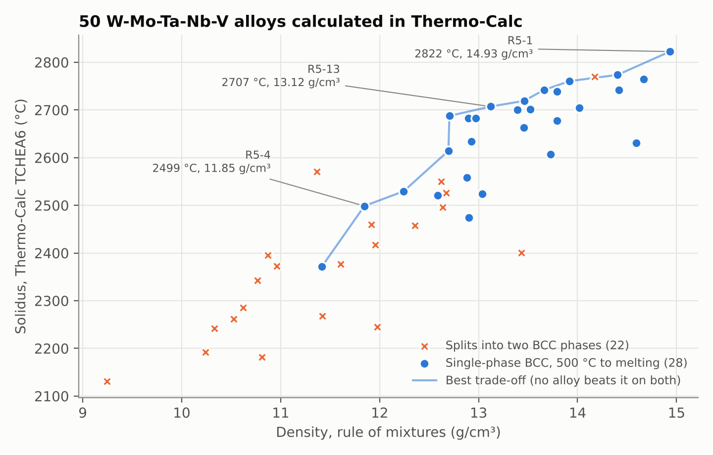
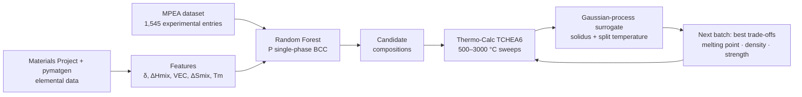
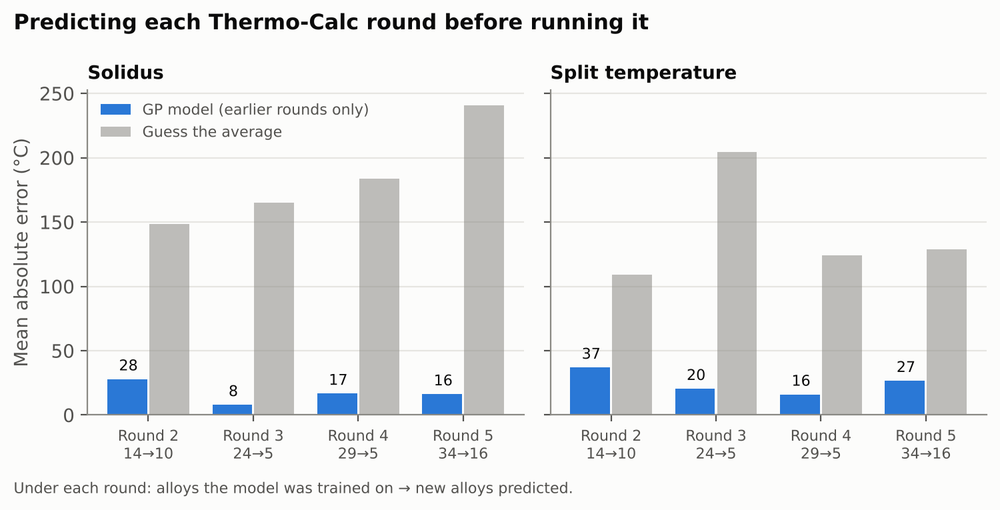

# Refractory high-entropy alloy discovery: ML + Thermo-Calc active learning

[](https://github.com/SeanMA668/hea-alloy-property-pipeline/actions/workflows/tests.yml)

A Python pipeline that searches the W-Mo-Ta-Nb-V alloy family for compositions that stay
**single-phase BCC** from 500 °C to melting. A machine-learning screen picks candidates,
Thermo-Calc (TCHEA6 v6.1) calculates them, and a Gaussian-process surrogate trained on
those results chooses the next batch.

**Result:** over five rounds, **50 alloys** were calculated and **28** were single-phase
BCC up to the solidus, the highest melting at **2822 °C**. Fitted only on earlier
rounds, the surrogate predicted each new round's solidus to within **8–28 °C** on
average, where guessing the average would miss by 148–241 °C.



## How it works



1. **Screen** (`pipeline/hea_model.py`): computes atomic-size mismatch δ, mixing
   enthalpy ΔHmix (Miedema pair values, checked against matminer), VEC, ΔSmix and Tm for
   10,000 random compositions, and trains a Random Forest on the MPEA experimental dataset
   (Borg et al., *Sci. Data* 2020) to estimate P(single-phase BCC).
2. **Calculate** (done by hand in Thermo-Calc Graphical Mode): equilibrium phase amounts
   from 500 to 3000 °C for each proposed composition, exported to `data/calphad/`.
3. **Learn and propose** (`pipeline/active_learning.py`, `pipeline/study_design.py`):
   Gaussian processes on composition predict the solidus and the temperature where the
   alloy splits into two BCC phases. Their uncertainty is calibrated by leave-one-out.
   The next batch spreads along the trade-off between melting point, density and
   predicted strength, plus a few "explore" points where the model is least sure.
4. **Report** (`pipeline/study_results.py`, `pipeline/figures.py`): writes
   [`reports/study_results.md`](reports/study_results.md) and the figures here.

## What the loop achieved



Each bar is a genuine forecast: the model saw only earlier rounds. The error does not
fall steadily, because later rounds deliberately probed new regions; what holds is that
it stays roughly 3–20× smaller than the no-model baseline.

| | Solidus (°C) | Density (g/cm³) | Composition (at.%) |
|---|---:|---:|---|
| Highest melting | 2822 | 14.93 | W35.0 Mo21.4 Ta28.8 Nb8.4 V6.4 |
| Balanced | 2707 | 13.12 | W31.9 Mo29.3 Ta10.0 Nb22.9 V5.9 |
| Lightest above 2450 °C | 2499 | 11.85 | W11.3 Mo17.2 Ta24.4 Nb35.0 V12.1 |

Full list: [`reports/study_results.md`](reports/study_results.md).

## Findings worth knowing

- **The cross-family ML classifier ties the textbook rules.** Under cross-validation
  grouped by chemical system, the Random Forest and the empirical δ/Ω/VEC rules both reach
  balanced accuracy 0.812 (AUC 0.89 for the forest). Within W-Mo-Ta-Nb-V its ranking
  agrees only weakly with Thermo-Calc (Spearman ρ = −0.37 against split temperature,
  n = 50). That is why the loop switched to a surrogate trained on Thermo-Calc itself.
- **The surrogate caught data-entry errors.** Two batches came back hundreds of degrees
  off prediction in one direction. Testing alternatives showed one batch was entered as
  mass % instead of mole %, and another was shifted one element over; both were confirmed
  and the runs kept at the compositions actually calculated (`data/rounds/`).
- **Composition pattern.** Single-phase alloys average 9.6 at.% V against 23.1 % for those
  that split, and contain more W and Ta. This is a pattern in these calculations, not a
  tested rule. The surrogate's slopes agree: +1 at.% V lowers the solidus by 18 °C and
  raises the split temperature by 9 °C ([`reports/sensitivity.md`](reports/sensitivity.md)).
- **Cost and supply risk.** At 2025 raw-material prices, Ta content explains 98 % of the
  cost spread between single-phase alloys; at the October 2026 tungsten price the
  low-W finalist becomes the cheapest. Every alloy in the family scores above the EU
  supply-risk threshold ([`reports/cost_supply.md`](reports/cost_supply.md)).

## Limitations

- **Calculated, not measured.** Every phase result is a TCHEA6 equilibrium calculation;
  none has been checked against experiment here. Scheil runs for two candidates are in
  [`reports/calphad_results.md`](reports/calphad_results.md).
- **Strength is rough.** The yield-strength model has a 202 MPa error on unseen alloy
  families, larger than the differences between candidates, so it only breaks ties.
- **Density** is a rule-of-mixtures estimate (median error 0.3 % on 31 measured alloys).
- **Not assessed:** ductility, oxidation, creep, processing.
- **Selection bias:** 28 of 50 single-phase reflects targeted sampling, not how common
  single-phase alloys are in the system.

## Reproduce

```bash
git clone https://github.com/SeanMA668/hea-alloy-property-pipeline.git
cd hea-alloy-property-pipeline
pip install -r requirements.txt

export MP_API_KEY=...            # optional; adds Materials Project structures to the report
python -m pipeline.hea_model     # screen + classifier        -> reports/results.md
python -m pipeline.hea_properties # density + strength         -> reports/properties_results.md
python -m pipeline.calphad_vs_ml # collect Thermo-Calc runs    -> data/calphad/calphad_vs_ml.csv
python -m pipeline.study_results # study summary              -> reports/study_results.md
python -m pipeline.figures       # README figures             -> reports/figures/
python -m pipeline.sensitivity   # composition sensitivity    -> reports/sensitivity.md
python -m pipeline.cost_supply   # cost + supply risk         -> reports/cost_supply.md
pytest                           # tests
```

To run another round: `python -m pipeline.study_design --batch 8` writes the next
compositions to `data/rounds/`. Calculate them in Thermo-Calc (mole %, W as balance,
500–3000 °C), save the tables as `data/calphad/hea_<ID>.csv`, then rerun the last three
commands. Thermo-Calc and the TCHEA6 database need their own licence.

## Repository layout

```
pipeline/   all code; run as python -m pipeline.<script>
data/       MPEA dataset, Thermo-Calc exports (data/calphad/), batch files (data/rounds/)
reports/    generated reports and figures
tests/      pytest suite (runs without Thermo-Calc or an API key)
docs/       literature notes, fact-checked by a multi-agent review (docs/research/)
```

## Credits

Built by [SeanMA668](https://github.com/SeanMA668). Code was written with an AI coding assistant (Claude);
the Thermo-Calc calculations, study design decisions and review are mine. Training data:
Borg et al., "Expanded dataset of mechanical properties and observed phases of
multi-principal element alloys", *Sci. Data* 7, 430 (2020), Apache-2.0
(`data/LICENSE-MPEA_dataset`).
