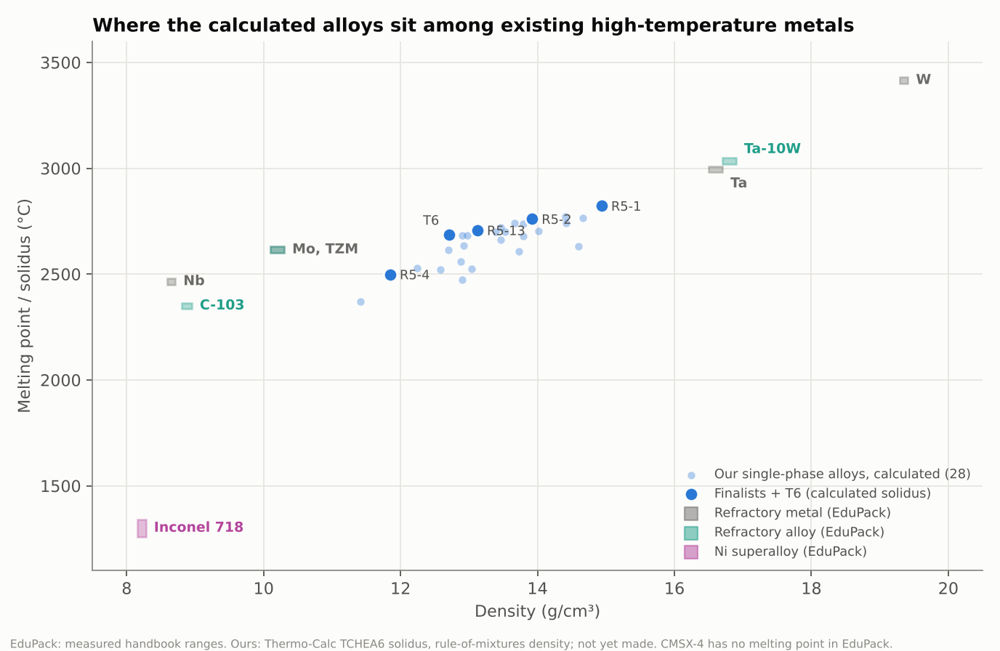

# Comparison with existing high-temperature metals

Generated by `pipeline/ashby.py`. Existing materials: Ansys Granta EduPack records (`data/edupack/`), measured handbook ranges. Our alloys: calculated (Thermo-Calc TCHEA6 solidus, rule-of-mixtures density), never made.

## EduPack data used

| Material | Density (g/cm³) | Melting point (°C) | Yield strength, RT (MPa) | Max service T (°C) | Price ($/kg) |
|---|---|---|---|---|---|
| W | 19.3–19.4 | 3410–3420 | 1350–1680 | 825–1210 | 40.2–69.2 |
| Mo | 10.1–10.3 | 2610–2620 | 170–350 | 867–1310 | 48.5 |
| Ta | 16.5–16.7 | 2990–3000 | 345–1060 | 1370–1980 | 375–442 |
| Nb | 8.6–8.7 | 2460–2470 | 75–95 | 547–737 | 127–145 |
| TZM | 10.1–10.3 | 2610–2620 | 770–950 | 867–1310 | 50.8 |
| C-103 | 8.8–8.95 | 2340–2360 | 260–380 | 520–700 | 573–589 |
| Ta-10W | 16.7–16.9 | 3030–3040 | 380–560 | 1370–2480 | 342–405 |
| Inconel 718 | 8.18–8.26 | 1260–1340 | 724–800 | 632–705 | 19–20.9 |
| CMSX-4 | 8.7 | – | 900–1150 | – | 131–143 |

## Our finalists

| Alloy | Density (g/cm³) | Solidus (°C) | Raw-material cost, 2025 ($/kg) |
|---|---:|---:|---:|
| R5-1 | 14.93 | 2822 | 108 |
| R5-2 | 13.92 | 2760 | 84 |
| R5-13 | 13.12 | 2707 | 71 |
| R5-4 | 11.85 | 2499 | 108 |
| T6 | 12.70 | 2688 | 60 |

## Reading

- **The gap the alloys aim at.** In this EduPack set nothing sits between Mo/TZM (2610–2620 °C at 10.1–10.3 g/cm³) and Ta/Ta-10W (2990–3040 °C at 16.5–16.9 g/cm³). R5-1, R5-2, R5-13 and T6 are calculated to fall in that gap (solidus 2688–2822 °C at 12.7–14.9 g/cm³): hotter than Mo alloys, lighter than Ta alloys.
- **R5-4 does not win on these two axes alone:** Mo and TZM are both lighter and higher-melting. Its case rests on other properties (it is the lightest finalist and the least exposed to tungsten price), which this chart does not show.
- **Against Ni superalloys** (the incumbent for turbine hot sections): Inconel 718 melts at 1260–1340 °C; the finalists' calculated solidus is about 1160–1560 °C higher, at 1.4–1.8× the density.
- **Price mark-up varies by element.** Comparing EduPack's finished-metal prices with the raw-material prices in `cost_supply.md`: W ($40–69 vs $48/kg) and Mo ($48.5 vs $51) cost about the same finished; Ta ($375–442 vs $220) about 2×; Nb ($127–145 vs $40) about 3–3.6×. So the raw-material cost understates Ta- and Nb-rich alloys most, which makes R5-1 and R5-4 relatively more expensive than `cost_supply.md` shows.

## Limits

- Calculated solidus vs measured melting point; calculated vs handbook density.
- No strength comparison is drawn: our strength estimates are not reliable enough (`finalists.md` §3), and EduPack's are room-temperature values for wrought or annealed material.
- EduPack 'maximum service temperature' for refractory metals reflects oxidation and recrystallisation limits; oxidation is not assessed for our alloys.
