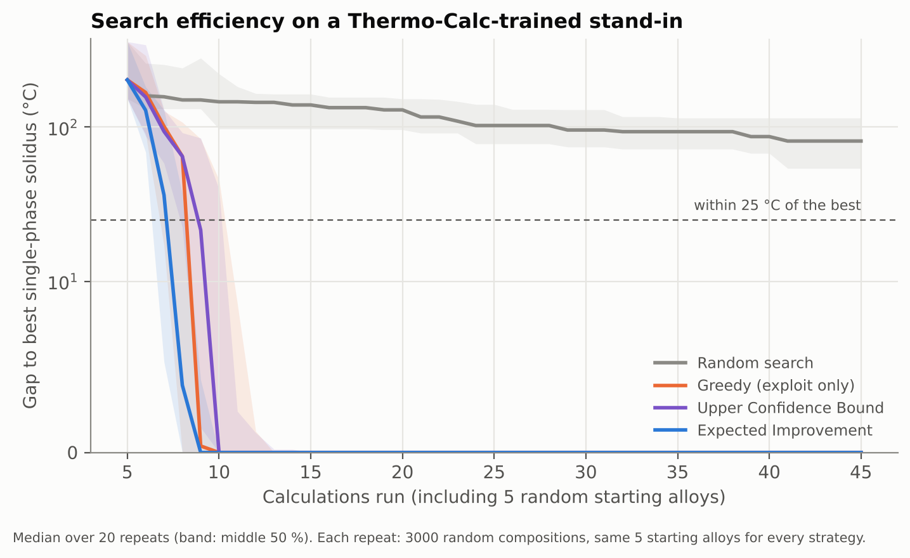

# Search-strategy benchmark

Compares how quickly four strategies find the highest-melting single-phase BCC alloy. **This is a benchmark on a stand-in, not new Thermo-Calc data:** the 'truth' is a Gaussian process (Matern kernel) fitted to all 50 Thermo-Calc results, and the searching model uses a different kernel (RBF). It measures search efficiency on a landscape shaped like this alloy system. Generated by `pipeline/benchmark_search.py`.

Setup: 20 repeats, each a pool of 3000 random compositions (5-35 at.% per element); every strategy starts from the same 5 random alloys and runs one alloy per step for up to 40 steps. 'Found' = a single-phase alloy within 25 °C of the best single-phase solidus in the pool.

| Strategy | Found within budget | Median runs to find (incl. 5 starts) | Median gap after 20 runs (°C) |
|---|---:|---:|---:|
| Random search | 3/20 | > 45 | 129 |
| Greedy (exploit only) | 20/20 | 9 | 0 |
| Upper Confidence Bound | 20/20 | 10 | 0 |
| Expected Improvement | 20/20 | 8 | 0 |

Random search would need about **550 runs** on average (median over repeats of 1 / fraction of the pool that qualifies), against 8–10 for the model-guided strategies. On this smooth stand-in the three model-guided strategies perform about the same; the difference that matters is model-guided vs random.

Notes: the median counts repeats that never found the target as 'not found'; the stand-in is smooth and noise-free, which favours model-based strategies relative to the real, harder landscape; the pool is restricted to 5–35 at.% per element like the real study.
