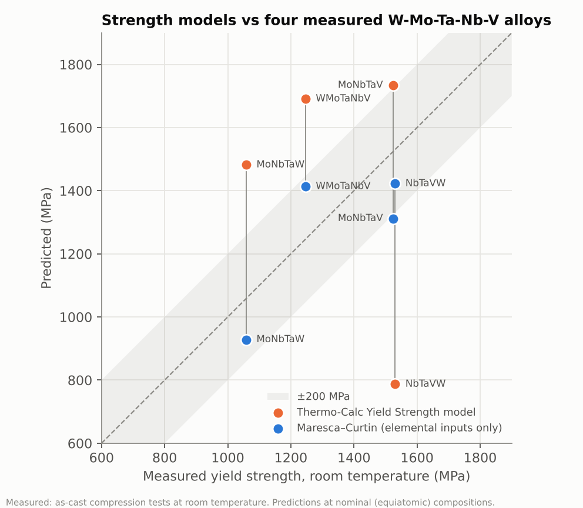

# Physics-based strength model (Maresca–Curtin)

Reduced analytic edge-dislocation model of F. Maresca and W.A. Curtin, "Mechanistic origin of high strength in refractory BCC high entropy alloys up to 1900K", *Acta Mater.* 182 (2020) 235–249 (doi:10.1016/j.actamat.2019.10.015); equations checked against arXiv:1901.02100v3, as the published version was not available. Inputs are elemental only: Vegard's-law atomic volumes from room-temperature lattice parameters and rule-of-mixtures elastic constants (sources in the code). Nothing is fitted to measured data; the reduced model's prefactors were fitted by the authors to their full theory (about 10 % scatter). Room temperature (296 K), strain rate 10⁻³ s⁻¹ (the NbTaVW test used 5 × 10⁻⁴ s⁻¹; see below), Taylor factor 3.067. Checked by research run `docs/research/run-2026-11-13` (SIGN-OFF: PASS). Code: `pipeline/strength_model.py`.

## 1. Validation against measured strengths

| Alloy | Measured (MPa) | Maresca–Curtin (MPa) | Error | Thermo-Calc (MPa) | Error |
|---|---:|---:|---:|---:|---:|
| WMoTaNbV | 1246 | 1413 | +167 | 1691 | +445 |
| MoNbTaW | 1058 | 928 | -130 | 1482 | +424 |
| NbTaVW | 1530 | 1422 | -108 | 787 | -743 |
| MoNbTaV | 1525 | 1312 | -213 | 1734 | +209 |

Spearman rank correlation with measured (n = 4): Maresca–Curtin ρ = 0.80, Thermo-Calc ρ = -0.20. Mean absolute error: Maresca–Curtin 154 MPa, Thermo-Calc 455 MPa.

With n = 4, ρ = 0.80 means one adjacent pair is swapped (WMoTaNbV and MoNbTaV); it is not statistically significant on its own. The clearer result is the error: every Maresca–Curtin prediction is within 213 MPa, and NbTaVW, which Thermo-Calc misses by 743 MPa, comes out close.

**Which temperature law.** At room temperature these alloys sit at τ/τ₀ ≈ 0.70–0.73, on the low-temperature branch of arXiv v3's two-form law (the switch at 0.5 is reached only around 700 K). Later papers from the same group attribute a single exponential form with exponent 0.91 to the published paper; which law it prints is unresolved. Under that form the four predictions are WMoTaNbV 1427–1450, MoNbTaW 934–951, NbTaVW 1434–1459, MoNbTaV 1319–1344 MPa (the range covers both placements of the 1/0.55 factor in the literature); mean absolute error 141–151 MPa, same ranking. The conclusions do not depend on the choice. The tables use arXiv v3.

**NbTaVW as tested.** The primary source (Yao et al., *Mater. Sci. Eng. A* 674 (2016), accepted manuscript OSTI 1482331, Table 2) gives σ0.2 = 1530 MPa (defined there as the stress at 0.2 % strain; whether it is an offset yield is not stated) for as-cast specimens (3 × 6 mm cylinders, 5 × 10⁻⁴ s⁻¹, room temperature). The ingot was not equiatomic: EDX gives Nb 28.50, Ta 29.65, V 20.67, W 21.18 at.% (Table 3). At that composition, 298 K and 5 × 10⁻⁴ s⁻¹ the model gives 1259 MPa (error -271 MPa), against 1422 MPa at the nominal composition. The table uses nominal compositions for all four alloys for consistency; the measured compositions of the other three have not been checked.

Thermo-Calc values were rerun on 2026-11-13 (Advanced mode, 1000 °C anneal, solid-solution strengthening on) and reproduced the earlier Simplified/1400 °C values to within 1 MPa, so the NbTaVW result is not a settings error.

## 2. Finalists

| Alloy | V (at.%) | μ (GPa) | ΔE_b (eV) | 25 °C | 1000 °C | 1300 °C | Thermo-Calc 25 °C |
|---|---:|---:|---:|---:|---:|---:|---:|
| R5-1 | 6.4 | 110 | 3.00 | 1239 | 579 | 450 | 1556 |
| R5-2 | 5.7 | 109 | 2.91 | 1177 | 537 | 414 | 1636 |
| R5-13 | 5.9 | 108 | 2.87 | 1154 | 519 | 399 | 1691 |
| T6 | 5.2 | 105 | 2.80 | 1116 | 492 | 375 | 1649 |
| R5-4 | 12.1 | 77 | 2.47 | 1084 | 424 | 312 | 1528 |

**Reading.** At 25 °C the finalists span 155 MPa, about the same as the model's 154 MPa mean error on the validation alloys, so room-temperature strength still cannot separate them with confidence. The order is the same at every temperature: R5-1 is strongest and R5-4 weakest, 450 vs 312 MPa at 1300 °C. R5-4 has the most V (in these near-equiatomic alloys V has the largest-magnitude misfit volume, being the smallest atom) but the least W, and its lower shear modulus and energy barrier outweigh the extra misfit. The high-temperature values are not validated here: the paper's own predictions fall below experiment at high temperature, so treat them as a ranking, not as design numbers.

## Caveats

- Four validation alloys, all as-cast. The compositions used are nominal (equiatomic); at least the tested NbTaVW was not equiatomic (see above).
- Edge dislocations only. Maresca and Curtin argue edge glide can control strength from moderate to high temperature and agrees with room-temperature data, but edge control of MoNbTaW and MoNbTaVW is predicted, not observed. In annealed VNbMoTaW at room temperature, Tsuru et al. (2024) found edge and screw segments present almost equally, similar edge (1210 MPa) and screw (1242 MPa) model strengths, both 25–30 % below measurement, and screw kink migration as rate-controlling. Room-temperature agreement of this edge model therefore does not show that edge glide controls strength.
- The paper reports its predictions fall below experiment at high temperature (the 900–1300 K plateau is not reproduced), so absolute high-temperature values are likely low; rankings are the intended use.
- Rule-of-mixtures elastic constants ignore alloying effects. For equiatomic MoNbTaVW, DFT gives C44 = 51 GPa against about 90 GPa from rule of mixtures (Maresca–Curtin Table 2, arXiv v3), but the authors note DFT is known to underestimate C44 in BCC metals and consider the EAM value more reliable.
- Elemental inputs: sources per element are in the code. Ta was changed from 0 K to 300 K elastic constants and to the NBS 25 °C lattice parameter on 2026-11-13; the Nb lattice parameter and C12 are not matched to a checked source.
